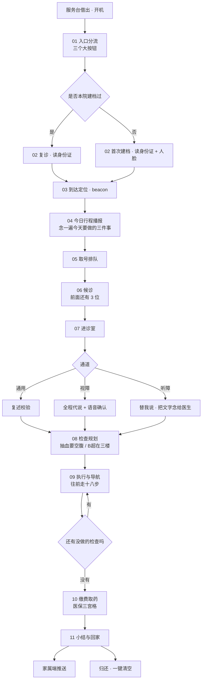

# 交互流程

> 交付物 `02_交互流程图/` 的三张图，正文在此。图用 Figma / FigJam 画，源文件放同目录。

## 1 主流程（happy path，一条线走到底）



## 2 三通道的交互契约（画成三条并列的泳道）

| 步 | 通用 | 视障 | 听障 |
| --- | --- | --- | --- |
| 进入 | 点一下按钮 | 长按任意位置 2 秒（唯一动作） | 点一下按钮 |
| 获取信息 | 看 | 听 | 看 |
| 确认 | 点「对，就是这样」 | 说"对"或再长按一次 | 点「明白了」 |
| 出错 | 大字提示 + 一个按钮 | 语音重播 + "再说一遍" | 大字提示 |
| 打断 | 求助键长按 1.5 秒 | 任意位置长按 | 求助键长按 1.5 秒 |
| 节奏 | 用户控制（不自动跳屏） | 语音控制（说完才走） | 用户控制 |

## 3 异常与降级（评委最爱看的一张）

```mermaid
flowchart TD
  S[任意步骤] --> E1{网络断了}
  E1 -- 是 --> S1[离线可用：行程/导航/三宫格全部本地<br/>屏幕顶部显示"离线也能用"]
  S --> E2{语音识别置信度 < 0.6}
  E2 -- 是 --> S2[不猜：把 2 个候选字放大并列<br/>"您说的是 心内 还是 心衰？"]
  S --> E3{用户问题超出范围}
  E3 -- 是 --> S3[拒绝但给出路：<br/>"这个我不能答，我帮您叫护士"<br/>→ 一键接通人工]
  S --> E4{长时间无操作 > 90 秒}
  E4 -- 是 --> S4[不弹窗、不熄屏、不催：<br/>语音轻声"我在这，您慢慢来"]
  S --> E5{电量低于 15%}
  E5 -- 是 --> S5[提前告知 + 引导回服务台换机<br/>（押金与借用记录一并转移）]
  S --> E6{设备被归还但流程未完成}
  E6 -- 是 --> S6[收尾清单：<br/>把没做完的事推给家属端]
```

## 4 关键交互细节（画进流程图旁注）

| 细节 | 规格 |
| --- | --- |
| 点击热区 | 最小 88×88 px（1024×600 基准），主按钮高 ≥ 120 px |
| 长按时长 | 求助 1.5 秒、视障进入 2 秒；有进度环，手指离开即取消 |
| 防误触 | 所有破坏性动作（清空、注销）需二次确认 + 长按 |
| 不自动跳屏 | 除"语音说完自动进入下一步"（视障通道）外，一律等用户动作 |
| 反馈 | 每次点击 80ms 内必须有视觉反馈（按下态即反馈，不等结果） |
| 语音速度 | 默认 1.0x，可调 0.8 / 1.0 / 1.2（老人默认 0.8） |
| 字号 | 正文 40px、按钮 44px、标题 54px（1024×600 基准），可全局 ×1.15 |
| 对比度 | 正文 ≥ 7:1（AAA），高对比模式 ≥ 12:1 |

## 5 演示脚本（视频/现场都照这个走，6 步 90 秒）

1. 服务台借出 → 入口分流（故意点错一次，展示"重选"）
2. 切到视障通道 → 全黑屏 + 一行大字 + "往前走十八步"
3. 切到听障通道 → 替我说 → 短句被念出来
4. 回到通用 → 复述校验（最关键的一次确认）
5. 故障注入 → ASR 置信度 0.41 → 系统说"我没听清，是这两个字里的哪个？"
6. 医保三宫格 → 一句人话 → 家属端收到推送

> 演示原则：**先出问题，再给答案**。评审记住的永远是"系统承认自己没听清"那一刻。
