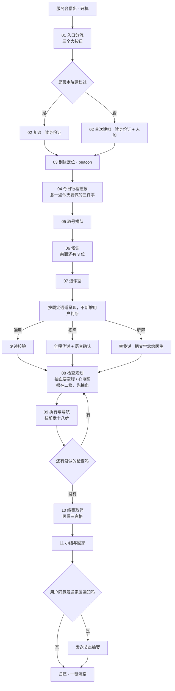

# 交互流程

> 交付物 `02_交互流程图/` 的三张图，正文在此。图用 Figma / FigJam 画，源文件放同目录。

## 1 主流程（happy path，一条线走到底）



## 2 三通道的交互契约（画成三条并列的泳道）

| 步 | 通用 | 视障 | 听障 |
| --- | --- | --- | --- |
| 进入 | 点一下磁贴 | 入口屏任意位置长按2秒；进入后松手，不沿用长按状态 | 点一下磁贴 |
| 获取信息 | 看 | 听 | 看 |
| 确认 | 点「对，就是这样」 | 说「对」；长按保留给求助，不兼任确认 | 点「明白了」 |
| 出错 | 大字提示 + 一个按钮 | 语音重播 + "再说一遍" | 大字提示 |
| 打断 | 求助键长按 1.5 秒 | 任意位置长按 1.5 秒求助 | 求助键长按 1.5 秒 |
| 节奏 | 用户控制 | 导航播报可继续；取号、缴费跳转、家属发送等决定须明确确认，沉默不视为同意 | 用户控制 |

## 3 异常与降级（评委最爱看的一张）

```mermaid
flowchart TD
  S[任意步骤] --> E1{网络断了}
  E1 -- 是 --> S1[仅使用已缓存且仍有效的行程、路线和费用演示快照<br/>缺失或过期时引导人工，不承诺全部离线可用]
  E1 -- 否 --> C1[继续原步骤]
  S --> E2{语音识别置信度 < 0.6}
  E2 -- 是 --> S2[不猜：把 2 个候选字放大并列<br/>"您说的是 心内 还是 心衰？"]
  E2 -- 否 --> C2[继续原步骤]
  S --> E3{用户问题超出范围}
  E3 -- 是 --> S3[拒绝但给出路：<br/>"这个我不能答，我帮您叫护士"<br/>→ 一键接通人工]
  E3 -- 否 --> C3[继续原步骤]
  S --> E4{长时间无操作 > 90 秒}
  E4 -- 是 --> S4[不弹窗、不熄屏、不催：<br/>语音轻声"我在这，您慢慢来"]
  E4 -- 否 --> C4[继续原步骤]
  S --> E5{电量低于 15%}
  E5 -- 是 --> S5[提前告知并引导回服务台换机<br/>借用记录由服务台核对；不承诺自动转移]
  E5 -- 否 --> C5[继续原步骤]
  S --> E6{归还前仍有未完成事项}
  E6 -- 是 --> S6[先显示未完成清单并询问是否发给家人<br/>同意才发送，拒绝则跳过，随后确认清空]
  E6 -- 否 --> C6[正常归还并确认清空]
```

六个「是」出口的恢复规则：S1在有效缓存可用时回原步骤，缺失/过期时转服务台；S2等待候选确认，两个都不是则重新表达，不能自动选；S3只在用户确认后联络人工，不可用时显示服务台方向；S4保持当前任务；S5由服务台处理换机与记录核对；S6经通知选择后进入归还与清空确认。拒绝通知也能归还。

## 4 关键交互细节（画进流程图旁注）

| 细节 | 规格 |
| --- | --- |
| 点击热区 | 最小 88×88 px（1024×600 基准），主按钮高 ≥ 120 px |
| 长按时长 | 求助 1.5 秒、01 进入视障通道 2 秒；02 任意位置长按 1.5 秒只求助，重播说「再说一遍」；手指离开即取消 |
| 防误触 | 所有破坏性动作（清空、注销）需二次确认 + 长按 |
| 不自动替用户决定 | 所有确认性动作须等待明确同意；语音完成不等于授权取号、缴费跳转或发送通知 |
| 反馈 | 每次点击 80ms 内必须有视觉反馈（按下态即反馈，不等结果） |
| 语音速度 | 默认 1.0x，可调 0.8 / 1.0 / 1.2（老人默认 0.8） |
| 字号 | 字阶、按钮和模式覆盖以 `04-视觉系统.md` 为准，不在流程文档另定 40 / 44 / 54px |
| 对比度 | 信息正文 ≥ 7:1；按钮与辅助文字的具体要求以 `04-视觉系统.md` 为准，不宣称全站统一 ≥ 7:1 |

## 5 演示脚本（视频/现场都照这个走，6 步 90 秒）

1. 服务台借出 → 入口分流（故意点错一次，展示"重选"）
2. 切到视障通道 → 全黑屏 + 一行大字 + "往前走十八步"
3. 切到听障通道 → 替我说 → 短句被念出来
4. 回到通用 → 复述校验（最关键的一次确认）
5. 故障注入 → ASR 置信度 0.41 → 系统说"我没听清，是这两个字里的哪个？"
6. 医保三宫格 → 一句人话 → 家属端收到推送

> 演示原则：**先出问题，再给答案**。评审记住的永远是"系统承认自己没听清"那一刻。

## 6 通道行为裁定

- 02 不显示独立求助键，导航无必需点按；任意位置长按 1.5 秒求助，语音「再说一遍」重播。01 长按 2 秒的进入动作仅在入口屏生效。
- 电梯只指引，不替患者按键。
- 03 由设备「念给医生听」，患者读取医生回复的字幕；听障通道限制的是依赖听觉获取信息。
- 共用状态条仅放设备与环境状态；语音引导进度是任务状态，不以屏名替代设备状态。
